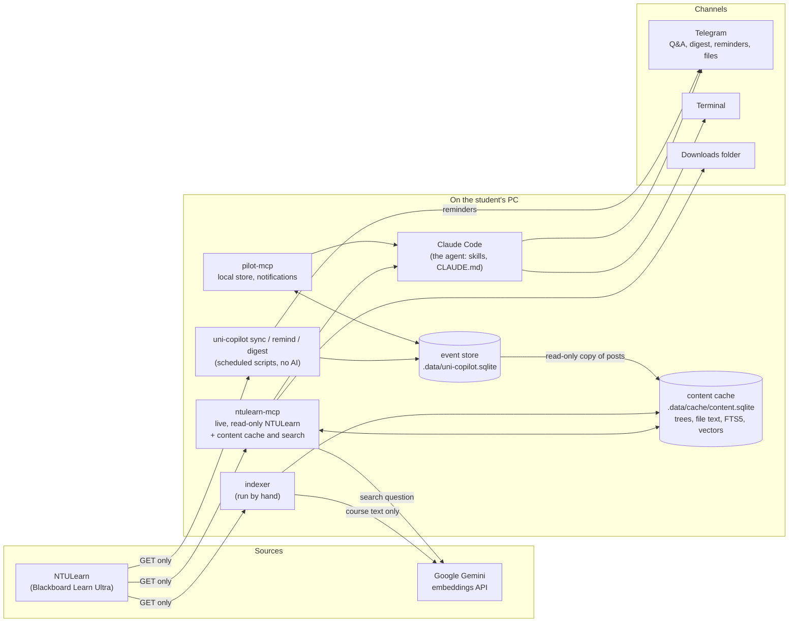

# uni-copilot

A personal academic agent for NTU (Nanyang Technological University) students. It reads NTULearn, NTU's Blackboard Learn Ultra site, into a local store on the student's own computer, then answers "what do I need to do?" and pushes what matters to Telegram. The agent is [Claude Code](https://docs.claude.com/en/docs/claude-code/overview). Two custom [MCP](https://modelcontextprotocol.io) servers give it read-only access to NTULearn and to the local store.

It runs locally with the student's own login. It never stores passwords, and it never writes anything to NTULearn.

```text
"What's due this week?"                 → a checklist from the local store, every item with its source and "as of" time
"Which IE2108 lecture explains Dijkstra?" → hybrid search over every slide and PDF, then the exact slide is read and cited
"Send me the week 11 lecture slides"    → after a "yes", the PDF arrives in the Telegram chat
07:30 every morning                     → a Telegram digest, only if something changed
24 h and 2 h before a deadline          → a reminder, unless the work is already handed in
```

> Unofficial student project. It isn't affiliated with or endorsed by NTU. Every user signs in with their own account, and all NTULearn access is read-only (HTTP GET only).

## Status

Built in phases. Each phase ends with something usable, and has its own design notes and build log in [`docs/`](docs).

| Phase | What | State |
|---|---|---|
| 0 | Spike: Playwright sign-in, cookies reused by plain `requests` | Done |
| 1 | `ntulearn-mcp`: courses, deadlines with submission status, announcements, course messages | Done |
| 2 | Local event store, scheduled `sync` with change detection, `pilot-mcp`, weekly checklist skill | Done |
| 3 | Telegram: Q&A from a phone, morning digest, deadline reminders, "mark as done" | Built, in a one-week real-use test |
| 4 | Course content and search: folders, pages, slide/PDF/notebook text, quiz details, hybrid keyword + meaning search, downloads, sending files to Telegram | Done |
| 5 | Lecture recordings and transcripts, lecture-notes skill | Planned |
| 6 | Google Calendar sync (confirmed writes), workload planner | Planned |
| 7 | More sources: academic calendar, exam and class timetables, forwarded messages, Outlook | Planned |
| 8 | Stretch: a live NTULearn "watcher" channel, groups, weekly review | Planned |
| 9 | Sharing: install guide, policy check, packaging | Planned |

The test suite has 272 offline tests on synthetic data, plus 4 opt-in live smoke tests.

## Architecture



Three layers:

1. **Sources.** NTULearn is reached only through `ntulearn-mcp`'s HTTP client: GET requests with cookies copied from a Playwright sign-in, paced at about one request per second. Google's Gemini API turns course text into vectors for meaning search.
2. **Core, on the PC.**
   - **The event store** (SQLite) is the single, normalised list of deadlines, announcements and messages. A scheduled `sync` fills it and records what changed.
   - **The content cache** (a second SQLite file) holds course trees, the text of slides, PDFs and notebooks, a full-text index, and embedding vectors.
   - **Two MCP servers** expose both to Claude.
3. **Channels.** Claude Code is the agent: in a terminal, in a Telegram session (via Claude Code's Telegram channel plugin), and headless for the morning digest. Plain scripts push reminders.

**Rule of thumb:** deterministic work runs as plain scripts with no AI (syncing, change detection, reminders). Judgement work runs in Claude Code (checklists, digests, answers from course material).

### The two MCP servers

**`ntulearn-mcp`**: live NTULearn plus its own content cache and search. Every tool is read-only on NTULearn.

| Tool | What it does |
|---|---|
| `login_status`, `login` | Checks the session; signs in silently from a saved browser profile, or opens a window when a real sign-in (with MFA) is needed |
| `list_courses` | The term's courses, grouped by subject code |
| `upcoming_deadlines` | Calendar ∪ gradebook due dates, deduplicated, each with the student's submission status |
| `recent_announcements`, `recent_messages` | Course announcements and course messages, as Markdown |
| `list_course_content` | One folder level: folders, pages, files, quizzes, each with its release condition |
| `read_page` | An Ultra page's text, its links and the files embedded in it |
| `read_file_text` | Text of a PDF, PPTX (with speaker notes), Jupyter notebook or text file, a few pages at a time |
| `get_assessment` | A quiz or assignment: attempts, password, lockdown browser, late attempts, due date (never a score) |
| `search` | Hybrid search over every cached slide, page, title, announcement and message |
| `download_file` | Saves one course file to `~/Downloads/uni-copilot/<COURSE>/` (asks every time; terminal only) |
| `send_course_file` | Sends one PDF/PPTX to the student's own Telegram chat, after an explicit "yes" |

**`pilot-mcp`**: the local event store. It's instant and never contacts NTULearn, and it's the default for everyday questions. Every answer says how fresh the data is ("as of …").

| Tool | What it does |
|---|---|
| `list_events`, `get_event` | Deadlines and posts from the store, with previews or full text |
| `whats_new`, `mark_seen` | Changes since a channel (terminal or Telegram) last looked |
| `sync_status` | When each source last synced, and any errors |
| `mark_done` | Marks a deadline handled outside NTULearn (e.g. Gradescope); confirmed in chat first |
| `send_telegram`, `delete_telegram_message` | Plain-text messages to the student's own chat (digest, "⏳" notes) |

### How a question flows

- **"What's due this week?"** Claude Code uses `pilot-mcp` (the local store) through the `weekly-actions` skill. The answer is a checklist with sources and "as of <time> SGT". NTULearn isn't contacted.
- **"Which lecture explains Dijkstra?"** `search` runs keyword search (SQLite FTS5, BM25) and meaning search (Gemini embeddings, cosine similarity) side by side. It merges the two ranked lists with reciprocal rank fusion. Claude then opens just the matching slide with `read_file_text` and cites the course, file and slide.
- **From Telegram:** the same routing. Hooks post a "💭 Thinking…" note while Claude works. Answers are short plain text. The Telegram session is locked down: no shell, no file or web tools, no sign-in, and no downloads.
- **Every morning:** Task Scheduler runs `uni-copilot digest`, which syncs if the store is stale. It then starts headless `claude -p` with the `morning-digest` skill, which messages Telegram only if something changed.

### Search: keyword and meaning together

- **Keyword:** SQLite FTS5 with Porter stemming and BM25 ranking, with titles weighted higher. Rows that contain more of the query words come first. Identical copies of a file are merged into one hit (`also_in`). Data files (`.csv`) are left out.
- **Meaning:** each slide or page becomes a chunk of up to about 300 words. Each distinct text gets one 768-number vector from `gemini-embedding-001`, so copies are embedded once. A question's vector is compared with every stored vector in a single numpy matrix product.
- **Merge:** reciprocal rank fusion. Each hit scores `1/(60 + rank)` in every list it appears in. A page found by both searches rises to the top, and each hit says `found_by` keyword, meaning or both.
- **Fallback:** if meaning search can't run (no key, limit reached, no prepaid credit, offline), the answer still comes back, as keyword-only results with a plain reason.
- **Measured** on one student's real courses: hybrid was better than or equal to keyword-only on 10 of 10 questions phrased without the slides' own words.

### Scheduled jobs: poke often, decide in code

Windows Task Scheduler only *pokes* commands on a timer. Whether anything is due is decided in Python from the store's state, so runs missed while the laptop sleeps catch up by themselves:

- `uni-copilot sync`: every 2 h from 07:00 to 23:00.
- `uni-copilot remind`: every 30 min. It sends 24 h and 2 h reminders and never sends one twice.
- `uni-copilot digest`: poked every 30 min, runs once a day after 07:30.
- The content indexer is run by hand after new material is posted.

File locks keep one sign-in, one sync and one indexer at a time. Details: [`docs/how-it-runs.md`](docs/how-it-runs.md).

## Security and privacy

- **Read-only on NTULearn.** The HTTP client has no method other than GET, and every NTULearn tool is annotated `read_only_hint=True`.
- **No passwords.** Sign-in happens in a real browser window (Playwright, with MFA). Only the browser profile is kept, in a git-ignored folder.
- **Secrets are never stored or printed.** That covers cookie values, the Telegram bot token, the Gemini key, and NTULearn's signed file links. Signed links are read fresh from the page each time, only for the download itself. The page parser hides them, the cache masks any that slip through, and no tool result has a field for them. Logs show names, status codes and counts only.
- **Untrusted text.** Announcements, messages, file names and course files are written by other people. Claude is told never to follow instructions found inside them, and nothing in them can trigger a tool.
- **What leaves the PC.** Course text (slides, pages, titles) and search questions go to Google's embeddings API. Announcements, messages and grades never do.
- **Grades** stay out by default. No grades tool exists yet. A future one is planned as opt-in only (`NTULEARN_ENABLE_GRADES=1`), never cached to disk and never sent to Telegram. Submission status is read without the grade fields.
- **Writes need confirmation.** Marking something done and sending a file both need an explicit "yes". `download_file` prompts every time in the terminal and is removed from the Telegram session.
- **Synthetic test data only.** No real course files, transcripts or grades are committed.

## Tech stack

- Python 3.12+, managed with [uv](https://docs.astral.sh/uv/)
- [MCP Python SDK](https://github.com/modelcontextprotocol/python-sdk) v2 (`MCPServer`, stdio transport)
- Playwright (Chromium) for sign-in only; `requests` for every data call
- SQLite for everything stored (WAL mode, FTS5 for full-text search); numpy for vector maths
- pypdf and python-pptx for file text
- Google Gemini `gemini-embedding-001` for embeddings
- Claude Code: skills, project instructions (`CLAUDE.md`), hooks, and the Telegram channel plugin; Telegram Bot API for pushes
- Windows Task Scheduler and PowerShell scripts for scheduling (the jobs themselves are plain CLI commands, so cron or systemd work the same way)

## Repository layout

```text
uni-copilot/
├── CLAUDE.md                  # rules and routing for Claude Code in this repo
├── docs/
│   ├── uni-copilot-project-plan.md   # full plan: architecture, roadmap, verified API facts
│   ├── how-it-runs.md         # what runs when, and what happens when the PC is off
│   └── phase 1/ … phase 4/    # per-phase design notes (core) and build logs
├── scripts/                   # PowerShell: schedule-sync / -remind / -digest, start-telegram
├── src/uni_copilot/
│   ├── ntulearn_mcp/          # MCP server 1
│   │   ├── server.py          # tools and server instructions
│   │   ├── auth/session.py    # Playwright sign-in, the only place that touches the browser
│   │   ├── client/            # http.py (GET only, pacing, retries, downloads) and one client per area
│   │   ├── parsers/           # HTML → Markdown, content trees, file text
│   │   ├── cache.py           # content cache, FTS5 index, chunks and vectors
│   │   ├── search.py          # keyword + meaning search, rank fusion
│   │   ├── embeddings.py      # chunking and the Gemini embedder (the only code that calls Gemini)
│   │   ├── indexer.py         # reads every course's files, then embeds new text
│   │   └── models.py          # pydantic models: what Claude receives
│   ├── store/                 # event store: schema, upsert + change detection, sync, queries, reminders
│   ├── sources/               # NTULearn → events adapters
│   ├── pilot_mcp/             # MCP server 2
│   ├── notify/                # Telegram Bot API sender, "thinking" note hooks
│   └── cli.py                 # uni-copilot sync | status | events | changes | remind | digest | notify | done
├── .claude/                   # settings.json (tool allow list), skills/, telegram-session.json (hooks)
├── tests/                     # offline tests, synthetic data only
├── .mcp.json                  # registers both servers with Claude Code
└── pyproject.toml
```

Local only, git-ignored: `.auth/` (browser profile), `.data/` (event store, content cache, logs), `.env` (tokens and settings), `data/` (personal timetable files).

## Getting started

This is a personal project, not yet packaged for others (that's Phase 9). It currently targets Windows and PowerShell. It needs an NTU account, a Claude plan with [Claude Code](https://docs.claude.com/en/docs/claude-code/overview), and optionally a Telegram bot and a Google Gemini API key.

```powershell
git clone https://github.com/tthymept/uni-copilot.git
cd uni-copilot
uv sync
uv run playwright install chromium
```

**First sign-in.** Open Claude Code in the folder (`.mcp.json` registers both servers) and ask it to run the `login` tool. A browser window opens for the NTU sign-in. After that, sign-ins happen silently from the saved profile.

**Settings** go in `.env` (git-ignored), one `KEY=value` per line, no quotes:

```text
TELEGRAM_BOT_TOKEN=...        # from @BotFather (Phase 3)
TELEGRAM_CHAT_ID=...          # found with: uv run uni-copilot telegram-chat-id
GEMINI_API_KEY=...            # meaning search (optional; without it search is keyword-only)
UNI_COPILOT_GEMINI_TIER=paid  # pacing for a billed Gemini project (default: free tier limits)
UNI_COPILOT_EMBEDDINGS=off    # optional: turn meaning search off
UNI_COPILOT_DOWNLOAD_DIR=...  # optional: where download_file saves
```

**Scheduled jobs:**

```powershell
powershell -ExecutionPolicy Bypass -File scripts\schedule-sync.ps1
powershell -ExecutionPolicy Bypass -File scripts\schedule-remind.ps1
powershell -ExecutionPolicy Bypass -File scripts\schedule-digest.ps1
```

**Telegram Q&A:** install Claude Code's Telegram channel plugin and [Bun](https://bun.sh), then keep this window open:

```powershell
powershell -ExecutionPolicy Bypass -File scripts\start-telegram.ps1
```

**Course content and search:**

```powershell
uv run python -m uni_copilot.ntulearn_mcp.indexer --dry-run   # what would be read, and how long
uv run python -m uni_copilot.ntulearn_mcp.indexer             # read every course's files, then embed new text
```

The first run reads everything (about an hour at one request every 2 s). Later runs only read what's new. Stopping with Ctrl+C is safe, and `--embed-only` carries on embedding without contacting NTULearn.

## Commands

```text
uv run uni-copilot sync | status | events | changes        # the event store
uv run uni-copilot remind [--dry-run] | digest [--force]   # pushes to Telegram
uv run uni-copilot done "<words or id>" [--undo]           # mark a deadline handled elsewhere
uv run uni-copilot notify "<text>" | telegram-chat-id
uv run ntulearn-mcp | pilot-mcp                            # the MCP servers (Claude Code starts them)
uv run python -m uni_copilot.ntulearn_mcp.server --self-test
uv run mcp dev src/uni_copilot/ntulearn_mcp/server.py      # MCP Inspector (needs the dev dependency mcp[cli])
```

## Testing

```powershell
uv run pytest                                              # offline, synthetic data
$env:NTULEARN_LIVE='1'; uv run pytest tests/test_live.py -s; Remove-Item Env:NTULEARN_LIVE   # live, counts only
```

The offline tests use fakes in place of NTULearn, Gemini and Telegram, and a made-up course (`tests/fake_ntulearn.py`). Besides the parsing, ranking and scheduling logic, they cover the safety rules:

- signed links never reach a tool result, the cache or an error
- downloads never follow a redirect to an unknown host
- file names from other people can't escape the downloads folder
- every Gemini failure gives a plain reason, never the key
- every tool is either pre-allowed or removed in the Telegram session

Most modules also have a self-test: `uv run python -m uni_copilot.ntulearn_mcp.<module>`.

## Roadmap

From [`docs/uni-copilot-project-plan.md`](docs/uni-copilot-project-plan.md):

- **Phase 5: recordings and study pipeline.**
  - `list_recordings` and `get_transcript`, for NTULearnVideo (Kaltura): Media Gallery recordings and videos embedded in course pages, with timestamped transcripts and "exam signal" segments.
  - A `lecture-notes` skill that turns a transcript into notes, corrected against the slides, plus a revision sheet and practice questions. Telegram gets a "notes ready" message.
- **Phase 6: Google Calendar.**
  - A calendar-sync skill that proposes deadline events and writes only after confirmation, deduplicated by an event marker.
  - A workload planner that counts back from deadlines and exams and proposes study blocks in free time.
- **Phase 7: more sources.**
  - The NTU academic calendar (teaching week numbers), exam and class timetables, and forward-to-add (forward a group-chat message to the bot, confirm, and it becomes an event).
  - Exam reminders, and NTU Outlook email if a connector works with NTU's tenant.
- **Phase 8: stretch.** A custom Claude Code channel that pushes new announcements and moved deadlines into a running session, plus groups and sign-up sheets, module progress and a weekly review.
- **Phase 9: share.** An install guide, a check of NTU's rules on automated access, and packaging.

Out of scope: writing to NTULearn, a web app, hosting anyone's NTU session on a server, reading other people's data, OCR, downloading videos, and speech-to-text for videos without transcripts.

## Documentation

- [`docs/uni-copilot-project-plan.md`](docs/uni-copilot-project-plan.md): goals, architecture, every source, roadmap, security rules, and verified facts about NTULearn's API
- [`docs/how-it-runs.md`](docs/how-it-runs.md): what runs when, catch-up after sleep, all commands
- `docs/phase N/phase-N-core.md`: each phase's design decisions; `phase-N-build-log.md`: step-by-step build notes with checks
- [`CLAUDE.md`](CLAUDE.md): the rules Claude Code follows in this repo

No license has been chosen yet.
